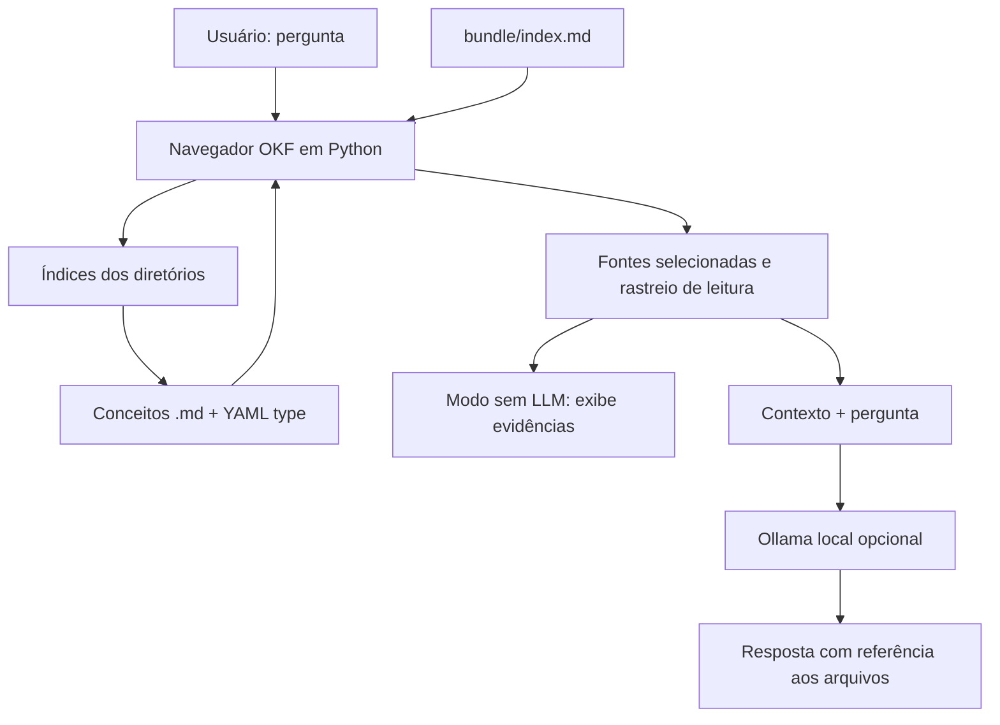

# OKF Vehicle Agent Lab — Open Knowledge Format v0.2

[](#testes)
[](#requisitos)

> **Laboratório educacional** de conhecimento estruturado para agentes de IA usando **Open Knowledge Format (OKF)**, Markdown, YAML e links. O domínio de exemplo é um catálogo **fictício** de veículos. Desenvolvido para comparar a navegação em arquivos com o laboratório de RAG, embeddings e HNSW.

## 1. O que é OKF?

**Open Knowledge Format (OKF)** é um formato aberto, independente de fornecedor, para representar **conhecimento** sobre dados e sistemas. Na versão **0.2**, um *bundle* é uma árvore de arquivos Markdown; cada conceito usa *frontmatter* YAML com o campo obrigatório `type`, e links Markdown estabelecem relações entre documentos. O arquivo `index.md` ajuda a descobrir o conteúdo progressivamente.

**OKF não é** um LLM, um índice vetorial, um algoritmo ANN, um banco de dados ou um concorrente obrigatório de RAG. É um **formato de conhecimento** que pode ser consumido por um agente, um leitor humano, um mecanismo de busca ou até uma aplicação RAG.

Referência canônica: [GoogleCloudPlatform/open-knowledge-format — SPEC v0.2](https://github.com/GoogleCloudPlatform/open-knowledge-format/blob/main/SPEC.md).

## 2. Objetivo da demo

Implementar um consumidor simples que:

1. Lê `bundle/index.md` como mapa inicial de conhecimento.
2. Escolhe links de acordo com os termos da pergunta.
3. Navega por índices de pastas e abre conceitos tipados.
4. Recupera evidências em arquivos Markdown, exibindo **quais arquivos foram realmente lidos**.
5. Opcionalmente envia as fontes selecionadas para um **LLM Ollama local** gerar a resposta, com instrução para citar os caminhos dos arquivos.

O modo **sem LLM** é determinístico e deliberadamente simples: usa **sobreposição lexical de tokens**, não embeddings, BM25, HNSW nem raciocínio autônomo. O modo **com Ollama** acrescenta *geração*, mas a escolha das fontes continua heurística; isso não é um agente com *tool calling* autônomo.

## 3. Arquitetura



Os links Markdown criam um **grafo de conhecimento**, mas não um grafo HNSW. HNSW é um algoritmo especializado em busca aproximada entre vetores; o OKF usa referências documentais comuns, editáveis por pessoas.

### Estrutura de pastas

```text
okf-vehicle-agent-lab/
├── README.md
├── main.py                     # CLI: valida, mapeia, recupera e chama Ollama
├── requirements.txt           # PyYAML
├── .gitignore
├── .github/workflows/ci.yml   # validação e testes no GitHub
├── tests/test_demo.py         # testes unitários
├── examples/
│   ├── perguntas.txt
│   └── saida-sem-llm.txt
└── bundle/
    ├── index.md                # mapa principal; okf_version: "0.2"
    ├── log.md                  # histórico de mudanças
    ├── tables/
    │   ├── index.md
    │   ├── vehicles.md
    │   ├── prices.md
    │   └── manufacturers.md
    ├── rules/
    │   ├── index.md
    │   ├── hybrid-classification.md
    │   └── vehicle-search.md
    ├── metrics/
    │   ├── index.md
    │   ├── average-price.md
    │   └── vehicle-count.md
    └── glossary/
        ├── index.md
        ├── suv.md
        └── hybrid.md
```

### Exemplo de conceito tipado

```yaml
---
type: Business Rule
title: Regra de classificação de SUV híbrido
description: Critério ilustrativo para identificar SUV com motorização híbrida.
tags: [regras, suv, hibrido]
status: draft
---
```

Após esse cabeçalho, o arquivo tem explicação em Markdown e links, por exemplo `[/tables/vehicles.md](/tables/vehicles.md)` — caminhos iniciados em `/` apontam para a raiz do *bundle* no nosso leitor.

## 4. Requisitos

- Linux Mint, macOS ou Windows com Python 3.10 ou superior.
- **PyYAML** para interpretar frontmatter; as demais funções usam biblioteca padrão do Python.
- **Opcional:** Ollama local com `qwen2.5:1.5b` para gerar respostas.
- **Não precisa:** ChromaDB, FAISS, Redis, OpenSearch, embeddings, GPU, API key ou conexão à Internet para o modo básico após instalar PyYAML.

## 5. Como instalar

```bash
# Descompacte o ZIP e abra a pasta
cd okf-vehicle-agent-lab

python3 -m venv .venv
source .venv/bin/activate
pip install -r requirements.txt
```

No Windows, ative com `.venv\\Scripts\\activate`.

## 6. Como executar

### 6.1 Validar a estrutura OKF

```bash
python3 main.py validar
```

Saída esperada:

```text
OK: bundle válido na checagem estrutural desta demo. Avisos: 0
```

A validação verifica: frontmatter YAML parseável, `type` não vazio, arquivos reservados, data no `log.md`, e links internos existentes. Para *links quebrados*, a demo avisa, mas não rejeita o bundle, de acordo com a conformance mínima da especificação. **Não é um validador completo de todas as recomendações opcionais da OKF v0.2.**

### 6.2 Ver o grafo de links dos índices

```bash
python3 main.py mapa
```

### 6.3 Perguntar sem modelo de IA

```bash
python3 main.py perguntar "Qual veículo é um SUV híbrido?"
```

A CLI mostra **rastro de leitura**, pontuação lexical das fontes, caminhos dos Markdown e linhas relevantes. Isso é recuperação por **navegação de links + texto**, não busca vetorial. O texto informa explicitamente que nenhuma resposta foi gerada no modo básico.

Mais exemplos:

```bash
python3 main.py perguntar "Como calcular preço médio dos veículos?"
python3 main.py perguntar "Qual tabela possui marca e modelo?"
python3 main.py perguntar "Qual é a política de busca de veículos?"
python3 main.py perguntar "O que significa SUV?"
```

### 6.4 Perguntar com Ollama local (opcional)

Em outro terminal (se necessário):

```bash
ollama serve
```

E instale o modelo caso ainda não esteja disponível:

```bash
ollama pull qwen2.5:1.5b
```

Consulte com geração:

```bash
python3 main.py perguntar "Qual veículo é um SUV híbrido?" --ollama
```

Ajuste o modelo:

```bash
python3 main.py perguntar "Qual veículo é um SUV híbrido?" --ollama --model qwen2.5:1.5b
```

O LLM recebe os documentos selecionados e a pergunta, sendo instruído a responder só com base neles e citar o caminho. **Isso não garante resposta correta:** modelos podem alucinar, não seguir instruções ou citar incorretamente; compare sempre com os documentos.

## 7. Experimentos para estudar

| Teste | Ação | O que observar |
|---|---|---|
| 1 | `python3 main.py mapa` | `index.md` indica caminhos; links são relacionamentos |
| 2 | Perguntar sobre SUV híbrido | A navegação deve chegar a `rules/hybrid-classification.md` e `tables/vehicles.md` |
| 3 | Perguntar sobre preço médio | O consumidor visita a métrica e/ou a tabela de preços |
| 4 | Modificar a descrição de um link no `index.md` | Pode mudar o caminho escolhido pelo algoritmo lexical |
| 5 | Alterar o modelo de veículo na tabela | O texto do bundle muda sem reindexação de embeddings |
| 6 | Criar um conceito sem `type` | `validar` deve reportar erro estrutural |
| 7 | Remover um arquivo apontado por link | `validar` emite aviso para link quebrado |
| 8 | Usar `--ollama` | O modelo usa as fontes selecionadas para sintetizar uma resposta |

### Detalhe importante sobre `index.md`

Nesse projeto o **índice** é um documento Markdown de navegação, **não** o índice invertido do Lucene nem o índice vetorial HNSW. O agente lê uma lista de conceitos e segue links. Essa diferença é central para compreender o diagrama apresentado no LinkedIn.

## 8. Comparativo com nosso RAG + ChromaDB

| Aspecto | OKF nesta demo | RAG com embeddings/HNSW |
|---|---|---|
| Fonte | Arquivos Markdown tipados e relacionados | Documentos transformados em embeddings |
| Recuperação | Navegação por `index.md` + heurística lexical | Busca por vizinhos vetoriais em índice ANN |
| Vetores | Não utiliza | Sim |
| Similaridade de cosseno | Não utiliza | Pode utilizar |
| HNSW | Não utiliza | Pode utilizar |
| Geração por LLM | Opcional, após recuperar | Geralmente usada no pipeline RAG |
| Principal ponto forte | Conhecimento explícito, auditável, navegável e versionável | Encontrar trechos por similaridade semântica |
| Limite típico | Qualidade dos links e da navegação | Qualidade do embedding, ranking, recall e custo |

**Eles podem funcionar juntos.** Por exemplo, um retriever vetorial pode indexar o conteúdo de arquivos OKF para ampliar a recuperação; o OKF permanece como a fonte organizada, com semântica e metadados.

## 9. Projetando um consumidor OKF mais robusto

Esta demo é limitada intencionalmente. Evoluções possíveis:

1. Seleção de links por um agente real com *tool calling*, limitando profundidade, número de leituras e permissões.
2. Metadados de confiança, origem (*provenance*), validade e revisão humana, conforme OKF v0.2.
3. Busca híbrida, combinando links de conceitos com BM25 ou embeddings.
4. Visualização interativa do grafo de conceitos.
5. Avaliação com perguntas gabaritadas: acerto, fontes corretas, latência, custo e rastreabilidade.
6. Leitura segura: impedir travessia de diretórios e tratar documentação como **dados não confiáveis**, não instruções de execução.

## 10. Testes

```bash
python3 main.py validar
python3 -m unittest discover -s tests -v
```

O conjunto de testes confere a estrutura do bundle, a navegação para SUV híbrido, a consulta de preço médio, o frontmatter, a normalização de acentos e a prevenção de acesso fora do bundle. Um workflow simples em `.github/workflows/ci.yml` executa esses testes a cada push/PR.

## 11. Como publicar no GitHub

```bash
git init
git add .
git commit -m "feat: laboratorio OKF v0.2 com navegacao e Ollama opcional"
git branch -M main
git remote add origin https://github.com/SEU-USUARIO/okf-vehicle-agent-lab.git
git push -u origin main
```

Crie previamente um repositório vazio com esse nome ou substitua a URL pela sua. O comando acima **não publica automaticamente** sem um repositório remoto configurado e autenticação válida.

## 12. Referências técnicas

- [GoogleCloudPlatform — Open Knowledge Format v0.2, especificação oficial](https://github.com/GoogleCloudPlatform/open-knowledge-format/blob/main/SPEC.md) — modelo de bundle, conceitos, `index.md`, links, metadados e conformidade.
- [GoogleCloudPlatform — repositório de referência e exemplos](https://github.com/GoogleCloudPlatform/open-knowledge-format) — implementações e bundles de exemplo.
- [OpenKnowledge — guia de compatibilidade OKF](https://openknowledge.ai/docs/workflows/supporting-open-knowledge-format) — exemplos de bundle mínimo e validação.
- Chip Huyen, *Engenharia de IA* — referência complementar de estudo para recuperação de contexto e RAG. **O código deste laboratório OKF não foi extraído desse livro**.

### Aviso

Os veículos, preços e regras aqui são **dados didáticos fictícios**; não são recomendação de compra nem representação de dados oficiais. A implementação é independente e **não afiliada ao Google**. O parser e a heurística são exemplificativos, e não uma implementação completa dos agentes ou ferramentas oficiais de OKF.
